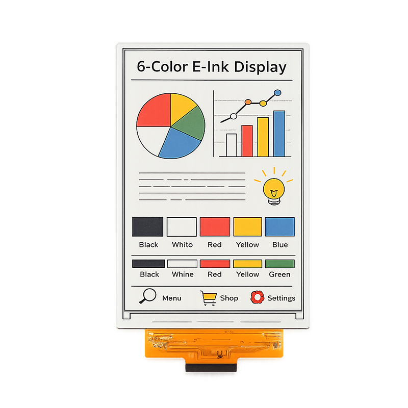

<p align="left"></p>

<h1 align="center">OSPTEK 7.09″ EPD Display 1200×1600 (EPD0709A02)</h1>

<p align="center"><b>EPD module · SPI/QSPI · NT61522x2+EK73601x1</b></p>

<p align="center"><a href="./README.md">简体中文</a> | English · <a href="../../README_EN.md">Family index</a></p>

<p align="center">
  
  
</p>

<p align="center"></p>

## Contents

- [Specifications](#specifications)
- [Resources](#resources)
- [Repository layout](#repository-layout)
- [Buy](#buy)
- [Support](#support)

---

## Specifications

| Item | Spec |
| ---- | ---- |
| Size | 7.09 inch |
| Type | EPD |
| Resolution | 1200×1600 |
| Outline | 117 x 157.7 x 0.9 mm |
| Active area | 108 x 144 mm |
| Interface | SPI/QSPI |
| Driver IC | NT61522x2+EK73601x1 |
| Touch IC | — |

> Full outline, FPC definition, power, and timing follow the product datasheet / driver IC datasheet.

## Resources

| Category | File |
| ---- | ---- |
| Datasheet | [`EPD0709A02.pdf`](./datasheets/EPD0709A02.pdf) |
| Adapter materials | [`PNG-1.jpg`](./adapter/PNG-1.jpg) |
| Adapter materials | [`7.09寸6色墨水屏V1.2.pdf`](./adapter/7.09%E5%AF%B86%E8%89%B2%E5%A2%A8%E6%B0%B4%E5%B1%8FV1.2.pdf) |

## Repository layout

```text
display-epd-7.09inch-1200x1600/ # repo root (nav: ../../README_EN.md; sample projects under root examples/)
└── versions/
    └── EPD0709A02/        # full materials for this part number
        ├── README.md
        ├── README_EN.md
        ├── osptek.yml
        ├── images/
        ├── datasheets/       # product datasheet + driver/touch IC datasheets
        └── adapter/          # adapter board materials + photos
```

## Buy

See the [repo home page](../../README_EN.md#where-to-buy).

## Support

See the [repo home page](../../README_EN.md#support).

---

<p align="center"><sub>© 2026 OSPTEK · Materials in this repository are licensed under CC BY 4.0</sub></p>
